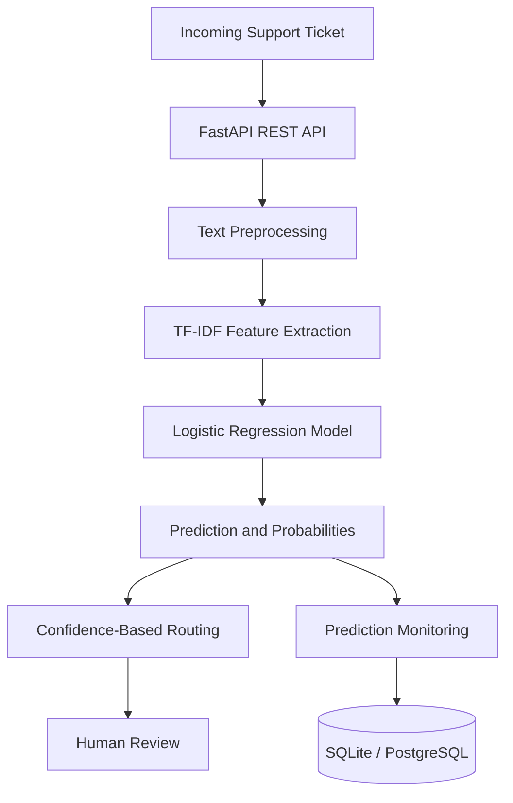

# Production-Grade Support Ticket Classification & MLOps Platform

An end-to-end machine learning and MLOps application that automatically classifies IT support tickets into eight categories, provides confidence-based routing decisions, and monitors predictions through a production-oriented API.


## Live Demo

- **Live API:** [Open Application](https://support-ticket-classifier-api-9q6z.onrender.com)
- **API Documentation:** [Swagger UI](https://support-ticket-classifier-api-9q6z.onrender.com/docs)
- **Health Check:** [Check API Status](https://support-ticket-classifier-api-9q6z.onrender.com/health/ready)
- **Monitoring:** [View Prediction Metrics](https://support-ticket-classifier-api-9q6z.onrender.com/monitoring)


---

## Project Overview

Support teams receive large volumes of tickets that need to be categorized and directed to the appropriate departments.

This project addresses that problem using machine learning and production-oriented engineering practices.

The application:

- Classifies incoming support tickets into eight categories.
- Uses TF-IDF text features and Logistic Regression.
- Produces prediction probabilities and confidence scores.
- Supports confidence-based routing evaluation.
- Sends uncertain predictions for human review.
- Exposes predictions through a FastAPI REST API.
- Stores prediction monitoring data in SQLite or PostgreSQL.
- Supports Docker-based deployment.

## Supported Categories

1. Access
2. Administrative rights
3. HR Support
4. Hardware
5. Internal Project
6. Miscellaneous
7. Purchase
8. Storage

## Machine Learning Performance

The project uses a TF-IDF-based Logistic Regression classifier.

| Metric | Baseline test result |
|---|---:|
| Accuracy | 85.38% |
| Macro F1-score | 85.46% |
| Weighted F1-score | 85.47% |

### Confidence-Based Routing Evaluation

The evaluated routing policy uses category-specific confidence thresholds.

| Metric | Result |
|---|---:|
| Test tickets | 7,176 |
| Automatically routed | 3,148 |
| Sent for human review | 4,028 |
| Correct automatic predictions | 3,108 |
| Incorrect automatic predictions | 40 |
| Automatic routing precision | 98.73% |

**Important:** The evaluated automatic-routing precision did not meet the project's 99% target. Automatic routing is therefore disabled in the deployed application. Predictions currently remain in human review.

## System Architecture



## Technology Stack

| Area | Technologies |
|---|---|
| Programming language | Python |
| Machine Learning | Scikit-learn |
| Text Processing | TF-IDF |
| Model | Logistic Regression |
| API | FastAPI |
| API Documentation | Swagger UI |
| Database | SQLite, PostgreSQL |
| Database Integration | SQLAlchemy, Psycopg |
| Containerization | Docker, Docker Compose |
| Deployment | Render |
| Cloud Database | Neon PostgreSQL |
| Testing | Pytest |
| Version Control | Git, GitHub |

## Production Features

### Machine Learning API
- REST API for support ticket classification.
- Prediction probabilities for all eight categories.
- Confidence scores.
- Input validation and structured responses.

### Monitoring
- Total prediction count.
- Category distribution.
- Routing distribution.
- Average confidence.
- Daily prediction counts.
- Last 24-hour and 7-day metrics.

### Database
- SQLite for local monitoring.
- PostgreSQL for cloud monitoring.
- Persistent prediction records.
- Database connection and transaction handling.

### Deployment
- Dockerized application.
- Environment-based configuration.
- Dynamic deployment port support.
- API readiness health check.
- Render and Neon integration.

## Live Deployment

The application is deployed using:

- **Application hosting:** Render
- **Database hosting:** Neon PostgreSQL
- **Container runtime:** Docker
- **Deployment branch:** `master`

Live endpoints:

| Endpoint | Purpose |
|---|---|
| `/health/ready` | Readiness check |
| `/docs` | Interactive API documentation |
| `/predict` | Support ticket classification |
| `/monitoring` | Prediction monitoring report |

The deployed API has been tested with a real support ticket, and the resulting prediction was verified in the Neon PostgreSQL database. Persistence was also checked after an application restart.

**Free-tier note:** The current deployment uses free-tier services. Availability, resource limits, and provider terms may change. Render free services can sleep after inactivity.

## Example API Request

**Endpoint:** `POST /predict`

```json
{
  "ticket_text": "My laptop screen suddenly stopped working. The display remains black even after restarting the device. Please help me resolve this issue."
}
```

Example response:

```json
{
  "predicted_category": "Hardware",
  "probabilities": {
    "Hardware": 0.7631823917571654,
    "Administrative rights": 0.06268213297365752,
    "Purchase": 0.043581395531839436,
    "Miscellaneous": 0.03448698475850662,
    "HR Support": 0.030505214556969917,
    "Access": 0.030161691094030083,
    "Internal Project": 0.01789867252398199,
    "Storage": 0.01750151680384908
  }
}
```

## Local Setup

### Prerequisites

- Python 3.12
- Git
- Docker Desktop (for containerized execution)

### Clone the repository

```bash
git clone https://github.com/Dilli-K22/production-grade-support-ticket-classification.git

cd production-grade-support-ticket-classification
```

### Create a virtual environment

Windows PowerShell:

```powershell
python -m venv .venv

.venv\Scripts\Activate.ps1
```

### Install dependencies

```powershell
pip install -r requirements.txt
```

### Configure environment variables

For local PostgreSQL monitoring, configure:

```powershell
$env:TICKET_DATABASE_URL="your-postgresql-connection-string"
```

For local SQLite monitoring, the application uses its configured SQLite database path by default.

Never commit database credentials or secrets to GitHub.

### Run the API

```powershell
uvicorn src.api:app --reload
```

Open:

```text
http://127.0.0.1:8000/docs
```

## Docker Setup

Build the Docker image:

```powershell
docker compose build
```

Start the application:

```powershell
docker compose up -d
```

Check container status:

```powershell
docker compose ps
```

Open the local API documentation:

```text
http://localhost:8000/docs
```

Stop the containers:

```powershell
docker compose down
```

Note: This command preserves named Docker volumes. Do not use `docker compose down -v` if you want to retain monitoring data.

## Testing

Run the test suite:

```powershell
pytest -v
```

For PostgreSQL integration tests, configure the isolated test database:

```powershell
$env:TEST_POSTGRES_DATABASE_URL="your-local-test-database-url"
pytest -v
Remove-Item Env:TEST_POSTGRES_DATABASE_URL
```

The PostgreSQL integration tests require a dedicated local test database named `ticket_monitoring_test`.

**Previously verified test result:** 92 passed.

## Project Structure

```text
support-ticket-classifier/
│
├── src/
│   ├── api.py
│   ├── settings.py
│   └── monitoring/
│
├── models/
│   └── ticket_classifier.joblib
│
├── tests/
│   ├── unit/
│   └── integration/
│
├── Dockerfile
├── docker-compose.yml
├── requirements.txt
├── requirements-runtime.txt
├── requirements-ci.txt
├── README.md
└── .gitignore
```

This is a simplified overview; additional experiment, analysis, and project files are maintained in the repository.

## Skills Demonstrated

- Natural Language Processing
- Text Classification
- Feature Engineering
- Model Evaluation
- Confidence-Based Decision Systems
- REST API Development
- Database Integration
- PostgreSQL
- Docker Containerization
- Automated Testing
- Cloud Deployment
- MLOps Monitoring
- Git and GitHub

## Future Improvements

- Human feedback and correction tracking.
- Model performance monitoring over time.
- Model retraining pipeline.
- Improved calibration and confidence thresholds.
- Production-grade observability.
- Automated deployment validation.
- Evaluation of safe automatic-routing policies.

## Author

**Dillikumaran V**

GitHub: https://github.com/Dilli-K22

---

*An end-to-end machine learning and MLOps engineering project.*
